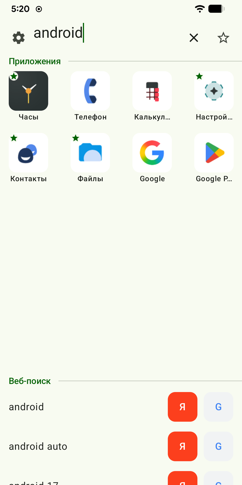
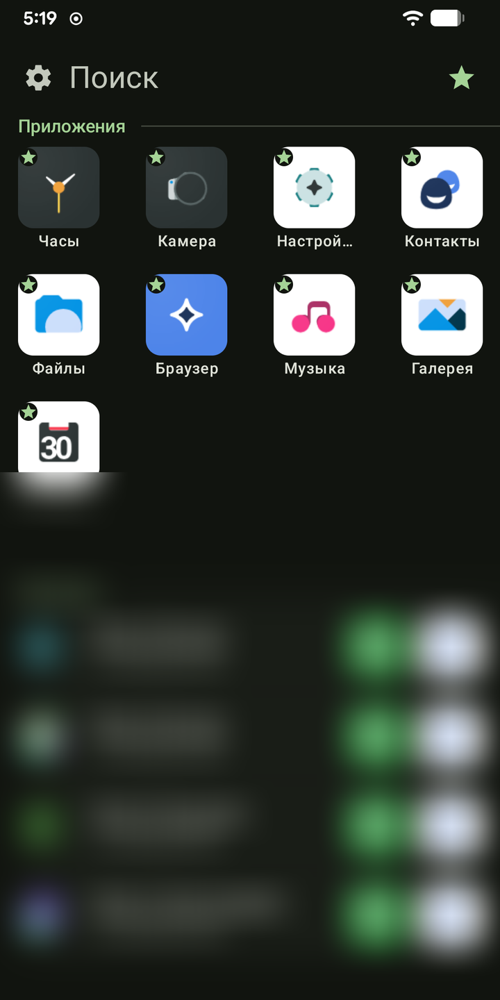
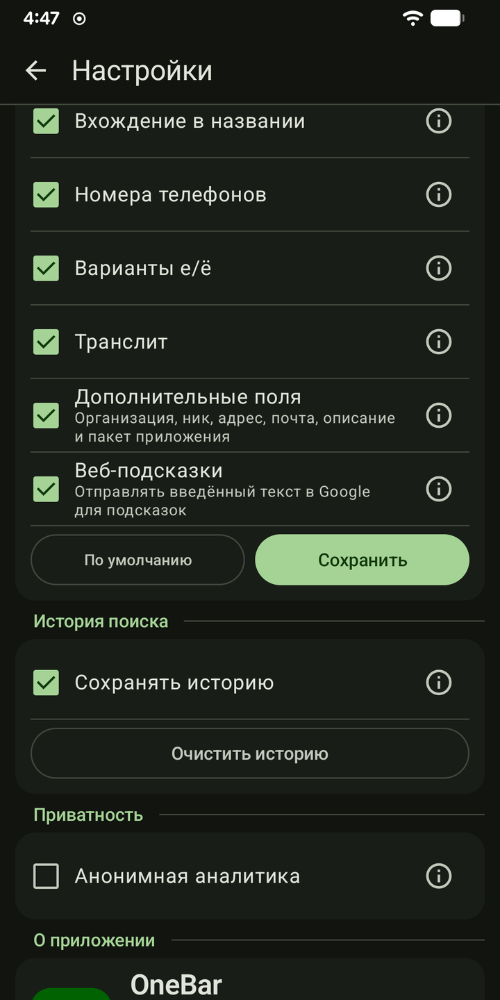

<div align="center">
  
  <h1>OneBar</h1>
  <p><strong>Приложения, контакты и веб-поиск в одной строке.</strong></p>
  <p>
    
    
    
    
  </p>
  <p>
    <a href="https://oneba.ru/">Сайт</a> ·
    <a href="https://github.com/croupier/OneBar/releases/latest">Скачать APK</a> ·
    <a href="https://github.com/croupier/OneBar/issues">Сообщить о проблеме</a>
  </p>
</div>

---

OneBar — небольшой некоммерческий Android-проект на Kotlin и Jetpack Compose. Он собирает установленные приложения, контакты и веб-подсказки в один быстрый поиск, чтобы не переключаться между лаунчером, телефонной книгой и браузером.

Проект учебный и развивается в свободное время. В нём нет рекламы, покупок и собственного аккаунта. Исходный код опубликован под MIT.

## Возможности

- Поиск по установленным приложениям и контактам.
- Номера, организации, должности, ники, заметки, адреса и почта в поиске.
- Точное совпадение, префикс, вхождение, е/ё, транслит и формы номера.
- История недавно открытых приложений и действий СМС/звонков.
- Избранное с сортировкой по частоте использования.
- Приоритет «история → избранное → остальное» без дублей.
- Веб-подсказки Google completion с возможностью отключения.
- Поиск в Яндексе и Google.
- Свайп-действия: СМС, звонок, Яндекс, Google.
- Светлая и тёмная темы, русский и английский языки.
- Настройка клавиатуры при старте и двойной «Назад» для выхода.
- Поисковый виджет.
- Добровольная обезличенная аналитика AppMetrica, выключенная по умолчанию.

## Скриншоты

<table>
  <tr>
    <td></td>
    <td></td>
    <td></td>
  </tr>
</table>

Полная презентация: [oneba.ru](https://oneba.ru/).

## Установка

Требуется Android 8.0 (API 26) или новее.

1. Откройте [GitHub Releases](https://github.com/croupier/OneBar/releases/latest).
2. Скачайте `OneBar-<версия>.apk` и `SHA256SUMS`.
3. Проверьте контрольную сумму.
4. Разрешите установку из выбранного источника, если Android попросит.
5. Установите APK и откройте OneBar.

Подробная инструкция и решение проблем: [сайт → Установка](https://oneba.ru/install.html).

OneBar не содержит самообновления. Новые версии скачиваются вручную из GitHub Releases. При обновлении APK должен быть подписан тем же ключом. Переход между GitHub и F-Droid может потребовать переустановки из-за разных ключей подписи.

## Приватность

- OneBar не запрашивает `READ_SMS` и `READ_CALL_LOG`.
- Контакты, история, избранное и настройки хранятся локально.
- `READ_CONTACTS` нужен только для поиска по контактам.
- `QUERY_ALL_PACKAGES` нужен для полного списка установленных приложений.
- Веб-подсказки отправляют введённый текст и язык в Google completion, если опция включена.
- AppMetrica включается только вручную в «Настройки → Приватность».
- В аналитику не отправляются тексты запросов, имена, номера, содержание сообщений или названия пакетов.
- Рекламные ID, App Set ID, геолокация, crash- и ANR-отчёты отключены; GMS исключён, MIT-адаптер App Set ID использует штатный fallback без идентификатора.
- Согласие на аналитику не переносится через системный backup.

Полная политика: [PRIVACY.md](PRIVACY.md) и [сайт](https://oneba.ru/privacy.html).

## Аналитика

Для Android используется открытый MIT SDK [AppMetrica 8.6.0](https://github.com/appmetrica/appmetrica-sdk-android). Бесплатный тариф включает безлимитные стандартные отчёты и базовые события, а также лимиты пользовательских событий: 3,25 млн в день и 100 млн в месяц по состоянию на ноябрь 2026.

API-ключ не хранится в репозитории. Без `APP_METRICA_API_KEY` приложение работает, но настройка аналитики недоступна. Инструкция: [docs/ANALYTICS.md](docs/ANALYTICS.md).

Сайт использует Umami Cloud после отдельного согласия. Бесплатный Hobby: 1 сайт, 100 000 событий в месяц, 6 месяцев хранения. Без website ID аналитика сайта не загружается.

## Разработка

### Требования

- JDK 17;
- Android SDK с Build Tools и platform API 36;
- Gradle wrapper из репозитория;
- Node.js 22+ для сайта.

Android Studio не обязателен. В `local.properties` укажите `sdk.dir`. Для подписи релиза используйте игнорируемый `keystore.properties`.

### Сборка и тесты

Windows:

```bat
set JAVA_HOME=C:\Tools\jdk-17
set HTTP_PROXY=
set HTTPS_PROXY=
set ALL_PROXY=
gradlew.bat testDebugUnitTest assembleDebug
```

macOS / Linux:

```bash
export JAVA_HOME=/path/to/jdk-17
unset HTTP_PROXY HTTPS_PROXY ALL_PROXY
./gradlew testDebugUnitTest assembleDebug
```

APK debug: `app/build/outputs/apk/debug/app-debug.apk`.

### Сайт

```bash
cd site
npm ci
npm run build
npm run check
npm run dev
```

Локальный адрес: `http://127.0.0.1:4173/OneBar/`. Tailwind собирается в статический CSS, шрифты лежат в репозитории, CDN для отображения сайта не нужен.

### Структура

- `app/` — Android-приложение, Compose UI, DataStore и тесты.
- `site/` — статический сайт на Tailwind CSS.
- `brand/` — исходная графика OneBar.
- `fastlane/metadata/android/` — описания, иконки, баннеры и скриншоты для каталогов.
- `docs/` — аналитика, распространение и релизный процесс.
- `.github/workflows/` — CI, GitHub Releases и GitHub Pages.

## Релизы и распространение

Основной канал первой публикации — **GitHub Releases**: подписанный APK, SHA-256, заметки релиза и исходный код. Google Play не планируется.

Также подготовлены материалы для:

- **F-Droid** — основная подача через merge request в `fdroiddata`;
- **IzzyOnDroid** — сторонний F-Droid-репозиторий, принимает APK из тегированных GitHub Releases;
- **собственного F-Droid binary repo** — максимальный контроль, но нужен сервер и обслуживание;
- **Accrescent** — пока регистрация разработчиков ограничена allowlist.

Шаги, требования и ограничения: [docs/DISTRIBUTION.md](docs/DISTRIBUTION.md). Процесс выпуска: [docs/RELEASING.md](docs/RELEASING.md).

## Известные ограничения

- Портретная ориентация; адаптация под планшеты, ландшафт и крупный шрифт ещё не завершена.
- Веб-подсказки зависят от доступности Google completion и интернета.
- Список приложений использует `QUERY_ALL_PACKAGES`; это допустимо для sideload, но ограничено политиками магазинов.
- Локальная история может содержать имена и номера контактов — не прикладывайте её к issue.
- Точное число sideload-установок недоступно: GitHub считает скачивания, AppMetrica — только согласившихся пользователей после первого запуска.
- Автоматической проверки обновлений пока нет; новые версии публикуются в GitHub Releases.

## Как помочь

- Сообщайте об ошибках через [Issues](https://github.com/croupier/OneBar/issues).
- Прикладывайте версию Android, модель, версию OneBar и шаги воспроизведения.
- Не публикуйте чужие контакты, номера, поисковые запросы или логи с персональными данными.
- Перед большой правкой обсудите идею в issue.

Правила: [CONTRIBUTING.md](CONTRIBUTING.md). Безопасность: [SECURITY.md](SECURITY.md).

## Лицензия

Код OneBar распространяется под [MIT](LICENSE). Графика проекта также распространяется под MIT, если в файле ресурса не указано иное. Сторонние библиотеки сохраняют собственные лицензии.
